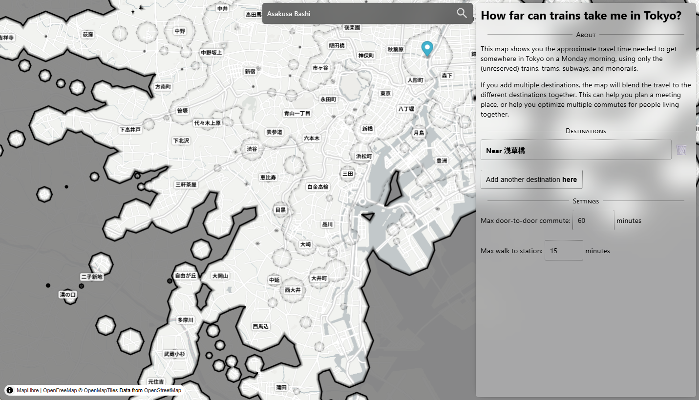

This webapp uses data I collected and aggregated from online sources into
expected wait+travel times for train-based commuting across the Tokyo region.

It was coded by hand using vanilla TypeScript, and renders using MapLibre GL.

# Demo

> 
>
> https://curtisfenner.com/tokyo-transit-iso/?p=139.788423_35.695869_w1_tNear+%E6%B5%85%E8%8D%89%E6%A9%8B&max=60&walk=15
